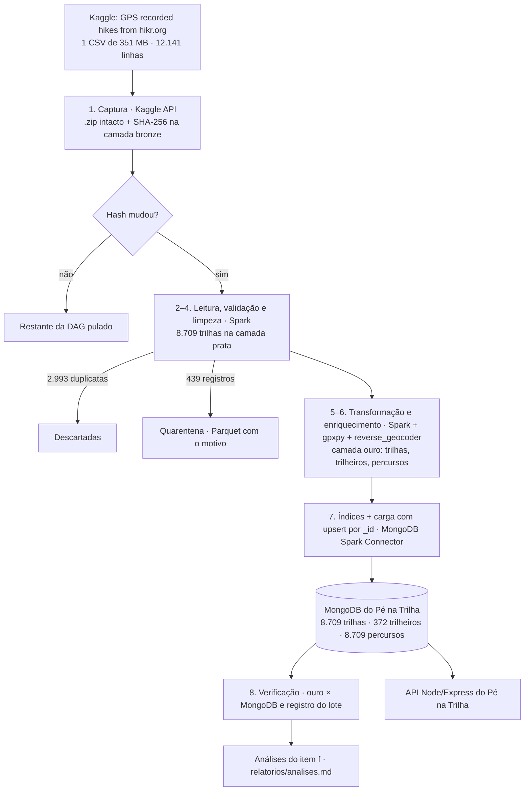

# Pipeline de Big Data do Pé na Trilha → MongoDB

**Avaliação N3 — Desenvolvimento com Linguagens Disruptivas I**
Equipe: Davi Martinelli Landal, Victor Schmitz Alvim de Oliveira e Hiago Farias Veloso.

Implementação do pipeline de ingestão especificado na Avaliação N2. As **12.141 linhas** do dataset
[GPS recorded hikes from hikr.org](https://www.kaggle.com/datasets/roccoli/gpx-hike-tracks) (Kaggle, CC0)
são capturadas, validadas, limpas, enriquecidas e carregadas no MongoDB do Pé na Trilha, onde viram
**8.709 trilhas, 372 trilheiros e 8.709 percursos com 1,45 milhão de pontos GPS**. A API do app já lista as
trilhas importadas.



## Tecnologias (as mesmas da N2, item g)

| Etapa | Ferramenta | Onde está |
| --- | --- | --- |
| Orquestração | Apache Airflow 2.10 (DAG `pe_na_trilha_ingestao`) | [dags/pe_na_trilha_ingestao.py](dags/pe_na_trilha_ingestao.py) |
| Captura | Kaggle API | [captura.py](penatrilha_pipeline/captura.py) |
| Processamento | Apache Spark 3.5 (PySpark, DataFrames, `mapInPandas`) | [leitura.py](penatrilha_pipeline/leitura.py), [validacao.py](penatrilha_pipeline/validacao.py), [limpeza.py](penatrilha_pipeline/limpeza.py), [transformacao.py](penatrilha_pipeline/transformacao.py) |
| Leitura do GPX | gpxpy | [gpx.py](penatrilha_pipeline/gpx.py) |
| Geocodificação reversa | reverse_geocoder (GeoNames, offline) | [transformacao.py](penatrilha_pipeline/transformacao.py) |
| Armazenamento intermediário | Bronze com o .zip original; prata, ouro e quarentena em Parquet com Snappy | [armazenamento.py](penatrilha_pipeline/armazenamento.py) |
| Carga | MongoDB Spark Connector 10.4 (upsert por `_id`) | [carga.py](penatrilha_pipeline/carga.py) |
| Destino | MongoDB 7 (local no Docker ou MongoDB Atlas) | [docker-compose.yml](docker-compose.yml) |
| Verificação e lote | pymongo + pyarrow | [verificacao.py](penatrilha_pipeline/verificacao.py) |
| Análises | agregações do MongoDB, pandas e scikit-learn | [analises.py](penatrilha_pipeline/analises.py) |
| Consumo pelo app | Node.js, Express e Mongoose | [../src](../src) |

## Pré-requisitos

- [Docker Desktop](https://www.docker.com/products/docker-desktop/) com **pelo menos 6 GB de memória** para o Docker
  (Settings → Resources) e cerca de 6 GB livres em disco.
- Internet na primeira execução (imagens Docker e download de 60 MB do Kaggle).
- Node.js 20+ só para rodar a API do Pé na Trilha com os dados importados.

## Como executar

Os comandos das etapas 1 a 3 são executados dentro da pasta `pipeline/` do backend.

### 1. Subir o ambiente

```bash
cd pipeline
docker compose up -d --build
```

Na primeira vez a imagem do Airflow é construída (Java 17, PySpark e o conector do MongoDB). Isso leva de 5 a 10 minutos.
Depois sobem três serviços:

| Serviço | Endereço | Acesso |
| --- | --- | --- |
| Apache Airflow | <http://localhost:8080> | usuário `admin`, senha `admin` |
| mongo-express (visualizar o banco) | <http://localhost:8081> | usuário `admin`, senha `admin` |
| MongoDB | `mongodb://localhost:27017` | banco `penatrilha` (também abre no MongoDB Compass) |

Confira se tudo está de pé com `docker compose ps`: o Airflow leva cerca de 1 minuto para ficar `healthy`.

### 2. Executar a DAG

1. Abra o Airflow em <http://localhost:8080> e entre com `admin` / `admin`.
2. Clique na DAG **`pe_na_trilha_ingestao`** e depois em **Trigger DAG** (▶). Abre um formulário com o
   parâmetro **Forçar reprocessamento**; na primeira execução pode deixá-lo desmarcado. Clique em **Trigger**.
3. Acompanhe na aba **Graph**: as oito tarefas ficam verdes em cerca de **5 minutos**.

A captura calcula o SHA-256 do arquivo. Se o dataset não mudou desde o último lote concluído,
`verificar_novidade` pula o restante (as tarefas ficam rosa, *skipped*). Para processar de novo mesmo assim,
marque **Forçar reprocessamento** (`forcar = true`) no formulário.

Pelo terminal, sem abrir a interface:

```bash
docker compose exec airflow airflow dags trigger pe_na_trilha_ingestao -c '{"forcar": true}'
```

No PowerShell do Windows, escape as aspas do JSON: `-c '{\"forcar\": true}'`.

Ou, sem o Airflow (mesmo código, em um único processo, útil para depurar):

```bash
docker compose exec airflow python -m penatrilha_pipeline.executar --forcar
```

### 3. Ver as saídas

| Saída | Onde ver |
| --- | --- |
| Relatório do lote (funil, quarentena, regras, comparação com a N2, documentos de exemplo) | [relatorios/ultimo_lote.md](relatorios/ultimo_lote.md) |
| Análises do item f da N2 | [relatorios/analises.md](relatorios/analises.md) |
| Coleções `trilhas`, `trilheiros`, `percursos` e `lotes` | <http://localhost:8081> → banco `penatrilha` |
| Camadas do data lake (bronze, prata, ouro, quarentena) | `docker compose exec airflow ls -R /opt/airflow/dados` |
| Logs de cada tarefa | Airflow → DAG → tarefa → **Logs** |

Consultas de exemplo no `mongosh` (`docker compose exec mongodb mongosh penatrilha`):

```js
// Documento da trilha de exemplo da N2
db.trilhas.findOne({ _id: ObjectId("5afb229e8f80884aaad9c6ea") })

// Trilhas a até 10 km de Zermatt (índice 2dsphere)
db.trilhas.aggregate([
  { $geoNear: { near: { type: "Point", coordinates: [7.7491, 46.0207] },
                distanceField: "distancia_m", maxDistance: 10000, spherical: true } },
  { $limit: 5 }, { $project: { titulo: 1, distancia_m: 1 } }
])

// Perfil de dificuldade (consulta da N2)
db.trilhas.aggregate([
  { $match: { "qualidade.tem_tempo": true, "qualidade.tem_elevacao": true } },
  { $group: { _id: "$dificuldade.grau", trilhas: { $sum: 1 },
              distancia_media_km: { $avg: "$metricas.distancia_km" },
              subida_media_m: { $avg: "$metricas.subida_m" } } },
  { $sort: { _id: 1 } }
])

// Histórico de lotes
db.lotes.find({}, { status: 1, finalizado_em: 1, "contagens.mongodb.trilhas_importadas": 1 })
```

### 4. Ver as trilhas importadas na API do Pé na Trilha

Na raiz do backend, aponte o `.env` para o mesmo MongoDB e suba a API:

```bash
# .env do backend
MONGO_URI=mongodb://localhost:27017/penatrilha
```

```bash
npm install
npm run dev
```

| Requisição | O que mostra |
| --- | --- |
| `GET /trilhas?limite=5` | as trilhas importadas, com `X-Total-Count` no cabeçalho |
| `GET /trilhas/5afb229e8f80884aaad9c6ea` | a trilha de exemplo da N2, buscada pelo `_id` original |
| `GET /trilhas/5afb229e8f80884aaad9c6ea/percurso` | os 119 pontos GPS dessa trilha |
| `GET /trilhas?dificuldade=3&distanciaMin=5&distanciaMax=10` | filtro por dificuldade e distância |
| `GET /trilhas/proximas?lat=46.0207&lon=7.7491&raioKm=10` | trilhas perto de um ponto (`$geoNear`) |
| `GET /trilheiros?limite=10` | ranking de trilheiros |
| `GET /analises/dificuldade` e `GET /analises/sazonalidade` | agregações do item f |

No frontend, a lista mostra 20 trilhas por vez (botão **Carregar mais**) e o total no painel lateral. As trilhas
importadas exibem o trilheiro do hikr.org, etiquetas de dificuldade, distância e subida e a descrição gerada pelo
pipeline. O cadastro, a edição e a exclusão continuam iguais.

## Saídas esperadas

Resultado do lote executado pelo Airflow na máquina da equipe, com 4 núcleos e 8 GB para o Docker: 8 tarefas
concluídas em 4 min 56 s (detalhes em [relatorios/ultimo_lote.md](relatorios/ultimo_lote.md)):

| Métrica | N2 (especificação) | N3 (execução) |
| --- | ---: | ---: |
| Linhas lidas do CSV | 12.141 | 12.141 |
| Duplicatas removidas (mesma `url`) | 2.993 | 2.993 |
| Trilhas únicas | 9.148 | 9.148 |
| Quarentena: GPX sem trilha gravada | 402 | 402 |
| Quarentena: distância acima de 100 km | 29 | 29 |
| Quarentena: distância abaixo de 0,5 km | 7 | 7 |
| Quarentena: GPX com XML inválido | 1 | 1 |
| **Trilhas carregadas** | **8.709** | **8.709** |
| Sem data e hora / tempo inválido | 1.273 / 113 | 1.273 / 113 |
| Sem elevação | 734 | 734 |
| Velocidade máxima acima de 36 km/h (anulada) | 99 | 99 |
| Alertas `provavel_bike_ou_esqui` / `subida_atipica` | 311 / 33 | 311 / 33 |
| Nomes com espaços extras | 475 | 475 |
| Trilhas com tempo e elevação completos | 7.255 | 7.255 |
| Trilheiros / percursos | 372 / 8.709 | 372 / 8.709 |

Documento gravado em `trilhas` para o primeiro registro do dataset:

```json
{
  "_id": { "$oid": "5afb229e8f80884aaad9c6ea" },
  "titulo": "Remsteinkopf, 1945 m",
  "descricao": "Trilha de 10,83 km com 613 m de subida e 610 m de descida, entre 1.323 m e 1.934 m de altitude. Dificuldade T2 (caminhada de montanha). Tempo em movimento: 3 h 23 min. Relato original: http://www.hikr.org/tour/post131855.html",
  "endereco": "Huttschlag, Salzburg, Áustria",
  "dificuldade": { "codigo": "T2", "grau": 2, "modificador": null, "nome": "Caminhada de montanha" },
  "localizacao": { "inicio": { "type": "Point", "coordinates": [13.227007, 47.231143] },
                   "cidade": "Huttschlag", "regiao": "Salzburg", "pais": "Áustria" },
  "metricas": { "distancia_km": 10.83, "subida_m": 613, "descida_m": 610, "altitude_min_m": 1323,
                "altitude_max_m": 1934, "tempo_movimento_min": 203, "duracao_total_min": 241,
                "velocidade_media_kmh": 3.21, "velocidade_max_kmh": 5.74 },
  "periodo": { "inicio": { "$date": "2018-05-11T07:37:40Z" }, "fim": { "$date": "2018-05-11T11:38:23Z" } },
  "trilheiro": { "_id": "hikr:Bergfritz", "usuario": "Bergfritz" },
  "qualidade": { "tem_tempo": true, "tem_elevacao": true, "alertas": [] },
  "origem": { "fonte": "hikr.org", "dataset": "roccoli/gpx-hike-tracks",
              "url": "http://www.hikr.org/tour/post131855.html", "post_id": 131855 }
}
```

## Opções

**Carregar no MongoDB Atlas do app.** Copie `.env.example` para `.env`, troque `MONGO_URI` pela URI do Atlas
(a mesma do backend) e recrie o contêiner do Airflow com `docker compose up -d`. A carga ocupa cerca de 90 MB
(50 MB em disco), o que cabe no plano gratuito (M0, 512 MB).
Trilhas cadastradas pelo app recebem `origem.fonte = "manual"` antes da primeira carga e nunca são sobrescritas.

**Usar o token da Kaggle.** Preencha `KAGGLE_USERNAME` e `KAGGLE_KEY` no `.env`. Assim a captura usa o comando
`kaggle datasets download`. Sem token, ela usa o endpoint público de download da mesma API.

**Executar sem internet.** Se o download falhar, a captura usa o `gpx-hike-tracks.zip` da pasta `entrada/` ou, se
ela estiver vazia, o último arquivo já guardado na camada bronze. Assim, depois da primeira execução, a DAG roda
mesmo offline.

## Testes

```bash
docker compose exec airflow python -m pytest tests -q
```

Os testes cobrem a leitura do GPX, os textos em português (descrição igual à do exemplo da N2) e as regras de
quarentena e limpeza aplicadas pelo Spark sobre registros sintéticos.

## Estrutura

```text
pipeline/
├── dags/pe_na_trilha_ingestao.py   # DAG do Airflow (8 tarefas)
├── penatrilha_pipeline/            # uma etapa da N2 por módulo
│   ├── captura.py                  # 1. Kaggle API → bronze
│   ├── leitura.py                  # 2. CSV multilinha com esquema explícito
│   ├── validacao.py                # 3. deduplicação, GPX e quarentena
│   ├── limpeza.py                  # 4. datas, unidades, dificuldade, alertas
│   ├── camada_prata.py             # job Spark das etapas 2 a 4
│   ├── transformacao.py            # 5. pontos, endereço, descrição, trilheiros → ouro
│   ├── armazenamento.py            # 6. Parquet (Snappy) e relatórios das etapas
│   ├── carga.py                    # 7. índices + upsert no MongoDB
│   ├── verificacao.py              # 8. ouro × MongoDB e registro do lote
│   ├── analises.py                 # análises do item f
│   ├── executar.py                 # execução completa sem o Airflow
│   ├── gpx.py, textos.py           # funções puras (testadas)
│   └── config.py, referencias.py   # caminhos, limites e escala SAC
├── tests/                          # pytest
├── relatorios/                     # saídas geradas pela DAG
├── entrada/                        # cópia local opcional do dataset
├── Dockerfile                      # Airflow + Java 17 + PySpark + conector
└── docker-compose.yml              # MongoDB, mongo-express e Airflow
```

Dentro do contêiner, o data lake fica no volume `data_lake`, montado em `/opt/airflow/dados`:

```text
bronze/kaggle/roccoli_gpx-hike-tracks/sha256=…/gpx-hike-tracks.zip + manifesto.json
prata/trilhas/                       (Parquet)
quarentena/trilhas/lote_id=…/        (Parquet, com motivo_quarentena)
ouro/trilhas/  ouro/trilheiros/  ouro/percursos/   (Parquet)
```

## Decisões de implementação

- **Spark em modo local** dentro do contêiner do Airflow. É o mesmo código PySpark: para usar um cluster, basta
  trocar `SPARK_MASTER`.
- **`_id` original como ObjectId.** O conector recebe `{"$oid": "…"}` com `convertJson`, então `GET /trilhas/:id` continua
  funcionando com os IDs do dataset.
- **Contagens das regras de limpeza.** Elas são calculadas sobre as 8.709 trilhas válidas, depois da quarentena.
  É sobre esse universo que os números da N2 (1.273, 113, 734…) batem.
- **Sem elevação** significa subida e descida iguais a 0 **e** nenhum `<ele>` no GPX (734 trilhas). Outras 7 trilhas
  têm `<ele>` gravado, mas sempre com valor 0; elas mantêm `tem_elevacao = true`, como na N2.
- **Endereço** vem do reverse_geocoder (GeoNames, offline): a cidade mais próxima do ponto inicial. Por isso a
  trilha de exemplo fica em “Huttschlag”, e não em “Großarl” (o exemplo da N2 foi consultado no Nominatim).
- **Idempotência.** Se o hash não mudou, o lote é pulado. Com `forcar = true`, o upsert por `_id` regrava os mesmos
  documentos sem duplicar.

## Parar e limpar

```bash
docker compose down        # para os serviços e mantém o banco e o data lake
docker compose down -v     # também apaga os volumes (banco e data lake)
```

**Problemas comuns.** Se uma porta já estiver em uso (8080, 8081 ou 27017), pare o serviço que a ocupa ou troque a
porta no `docker-compose.yml`. Se o Spark falhar por falta de memória, aumente a memória do Docker ou use
`SPARK_DRIVER_MEMORY=2g` no `.env`. No Linux, defina `AIRFLOW_UID=$(id -u)` no `.env` antes de subir.
